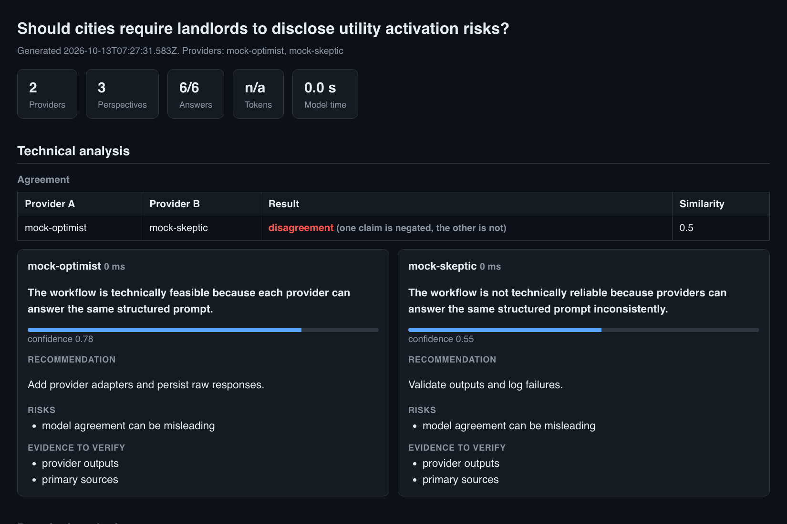
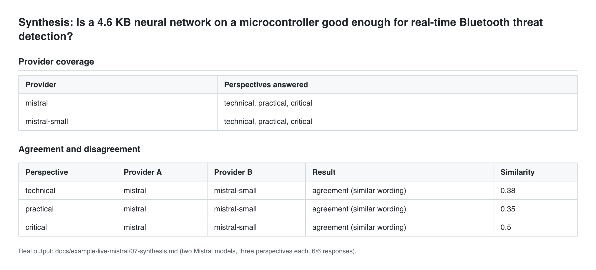

# Multi-Model Research Orchestrator

A small, provider-agnostic CLI for comparing independent AI perspectives on one research question and exposing where configured providers agree or disagree.

It turns an informal “ask several models” workflow into a reproducible artifact:

```text
question → every provider answers every perspective → comparison tables
                                                  → saved manifest + synthesis
```

The project was extracted from an earlier local multi-model research setup and rewritten for publication. It contains no credentials, no private MCP configuration, and no claim that model output is verified research.

## Why it exists

Single-model answers can hide assumptions. This tool deliberately separates three passes:

- **Technical:** feasibility, evidence quality, constraints, and failure modes.
- **Practical:** users, incentives, adoption barriers, and measurable outcomes.
- **Critical:** risks, affected stakeholders, and what would falsify the idea.

Each provider answers each perspective, so the same question is compared across models rather than merely rotating models between prompts. The synthesis parses each claim and confidence and compares providers pairwise with a transparent wording heuristic: word overlap, plus a check for negation so that "feasible" and "not feasible" are never reported as agreement. It does not pretend to fact-check the providers.

## Quick start: offline mode

Requires Node.js 20 or newer and no API key.

```bash
npm test
node bin/research.js "Should cities require landlords to disclose utility activation risks?" --mock
```

`--mock` runs two deterministic offline providers (`mock-optimist`, `mock-skeptic`) whose canned answers differ on purpose, so the synthesis shows both an agreement and a disagreement. They say nothing about any real model.

The command writes Markdown files, `manifest.json` and `report.html` under `research-output/`.

## Live providers

Credentials are read only from environment variables. Copy `.env.example` into your own shell configuration; never commit a `.env` file.

```bash
export OPENAI_API_KEY="..."
export OPENAI_MODEL="gpt-4o-mini"
node bin/research.js "What makes a useful student housing data tool?"
```

Supported providers:

| Provider | Variable | Default model (override with) |
|---|---|---|
| `openai` | `OPENAI_API_KEY` | `gpt-4o-mini` (`OPENAI_MODEL`) |
| `groq` | `GROQ_API_KEY` | `llama-3.3-70b-versatile` (`GROQ_MODEL`) |
| `mistral`, `mistral-small` | `MISTRAL_API_KEY` | `mistral-medium-latest` (`MISTRAL_MODEL`), `mistral-small-latest` (`MISTRAL_SMALL_MODEL`) |
| `anthropic` | `ANTHROPIC_API_KEY` | `claude-haiku-4-5-20251001` (`ANTHROPIC_MODEL`) |
| `gemini` | `GEMINI_API_KEY` | `gemini-flash-latest` (`GEMINI_MODEL`) |
| `ollama` (local, no key) | `OLLAMA_MODEL` (and `OLLAMA_HOST`, default `http://localhost:11434`) | the model you name |

A single `MISTRAL_API_KEY` gives two providers, so one key is enough for a real comparison. Ollama is only used when `OLLAMA_MODEL` is set, and then nothing leaves your machine. Each provider reports token usage when its API does, and the manifest records latency, tokens and whether an answer came from the cache.

**Verification status:** the OpenAI-compatible providers (OpenAI, Groq, Mistral) are covered by tests against a mocked `fetch`, and the Mistral path was also run live. The Anthropic, Gemini and Ollama providers are tested against a mocked `fetch` only; I have not called those live APIs, so treat their request shapes as unconfirmed until you try them.

## Options

```bash
node bin/research.js "Your question" [options]      # or: npx research-orchestrator ... after npm link
```

| Option | What it does |
|---|---|
| `--mock` | two offline mock providers, no key and no network |
| `--providers a,b` | use only these providers (an unknown name lists the available ones) |
| `--perspectives a,b` | use only some of the built-in perspectives (`technical`, `practical`, `critical`) |
| `--perspectives-file FILE` | your own perspectives: a JSON array of `{id, label, instruction}`, at most 6 |
| `--sources DIR` | give the models the `.md` and `.txt` files in DIR and verify their quotes (see below) |
| `--out DIR` | where results go (default `research-output`) |
| `--concurrency N` | calls in flight at once, 1 to 10 (default 3) |
| `--max-calls N` | refuse to start if the run would make more than N model calls |
| `--cache`, `--cache-dir DIR` | reuse earlier answers; rerunning after an interruption only pays for what is missing |
| `--no-report` | skip `report.html` |

### Sources and quote checking

With `--sources DIR` the prompt contains your documents (up to 20 files and 60,000 characters) and asks each model to back its claim with quotes copied exactly. The tool then checks that every quote really occurs in the file the model named (whitespace is ignored, everything else must match). The synthesis and the report show how many quotes were verified and list the ones that were not found. A verified quote shows that the text exists in that file; it does not show that the model understood it correctly.

### Cache

`--cache` stores successful answers in `./.research-cache/` (listed in `.gitignore`), keyed by provider, model and the full prompt. The files contain model output and, when you use sources, can echo your documents, so do not commit or share the folder.

### HTML report

Each run also writes `report.html`: a single page with the agreement tables, one card per provider and perspective (claim, confidence, recommendation, risks, evidence to verify), quote checks, and token and latency totals. Everything from a model or a file is escaped, and the page contains no script and loads nothing from the network.



The screenshot is of an offline mock run (the two providers are scripted, not real models).

## Output

For a question such as `Can this workflow be audited?` with two live providers configured:

```text
research-output/can-this-workflow-be-audited/
├── 01-openai-technical.md
├── 02-openai-practical.md
├── 03-openai-critical.md
├── 04-groq-technical.md
├── 05-groq-practical.md
├── 06-groq-critical.md
├── 07-synthesis.md      # numbered after the response files
└── manifest.json
```

With one provider the synthesis is `04-synthesis.md`. The comparison needs at least two providers.

The synthesis from a real run, with two Mistral models answering three perspectives each (the full files are in [`docs/example-live-mistral`](docs/example-live-mistral)):



## Design choices

- Sends every configured provider through every perspective.
- Uses a mock provider so the full workflow is testable offline.
- Saves provider names, statuses, parsed claims, and timestamps in a manifest for auditability.
- Escapes model output before placing it in Markdown tables.
- Retries transient rate-limit/server failures and aborts stalled requests with a timeout.
- Treats model output as an unverified draft and explicitly asks for evidence to verify.
- Keeps credentials outside the repository and does not write them to output files.

## Limitations

This is a research workflow prototype, not an autonomous fact-checker.

**The agreement check is weak, and it was measured.** It compares word overlap and looks for negation words. On 40 claim pairs that I labelled by hand before running it (40 pairs, 20 agree and 20 disagree, `eval/claim_pairs.json`), it matched my label 15 times (37.5%). On this balanced set guessing gets about 50%, so it did worse than chance overall. It is fine for near-identical wording (6/6) and mostly right on explicit negation (5/6), but it failed on paraphrases (2/7), paraphrases with little shared wording (0/7), opposite meanings without a negation word (0/8) and different conclusions (2/6). The pairs are a small sample written by one person, so the numbers are indicative, not a benchmark. Run `npm run eval` to reproduce them; `eval/results.json` lists every miss. Treat the "agreement" and "disagreement" labels as a prompt to read the claims yourself. A model-based judge or embeddings would be the next step; neither is implemented.

The OpenAI, Groq and Mistral adapters are tested against a mocked `fetch`, not against the live APIs (the Mistral path was also run live on 4 questions, 24 of 24 responses succeeded; the output of one run is in `docs/example-live-mistral/`, unedited and unverified model output). The Anthropic, Gemini and Ollama adapters have only been tested against a mocked `fetch`. Quote checking proves a quote exists in a file, not that it supports the claim. The tool does not browse sources, judge citation quality, guarantee factual agreement, or replace domain expertise. Live model availability, pricing, and output quality depend on the configured provider.

## Tests

```bash
npm test          # 51 tests, no network
npm run eval      # measures the agreement heuristic on eval/claim_pairs.json
```

The tests cover safe slugs, structured prompts, offline execution, provider coverage, negation and agreement detection, the claims table and its escaping, output file naming, environment configuration, authenticated requests for all five request styles, HTTP errors, empty responses, timeouts, retries, the concurrency limit, result ordering, the call limit, the cache, custom perspectives, quote verification, HTML escaping in the report, and the command-line options with their error messages.

## AI assistance

This repository was developed with AI assistance (Claude Code). The workflow, provider boundary, output schema, limitations, and tests were specified and reviewed by the author.

## License

MIT.
